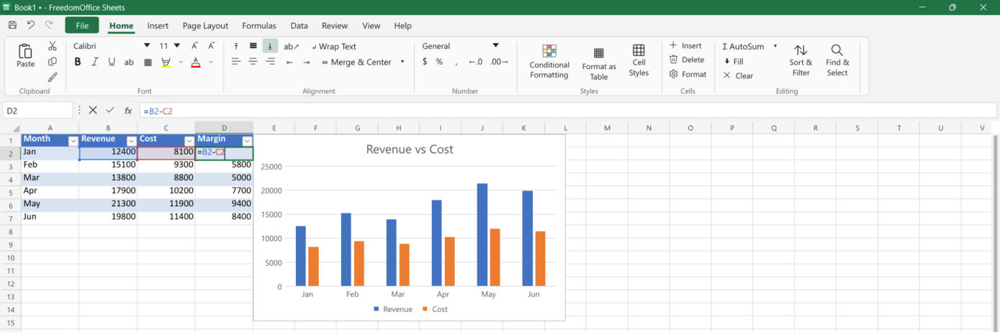

# FreedomOffice Sheets

A lightweight, open-source spreadsheet for Windows, written in Rust.
One portable ~13 MB executable — no installer, no runtime, no account needed.

It deliberately follows the familiar desktop-spreadsheet layout and keyboard habits
(ribbon, formula bar, Alt key sequences, Ctrl/Shift/F-key shortcuts), so years of
muscle memory keep working. It reads and writes `.xlsx`, so your existing workbooks open as they are.



## Download

Grab `FreedomSheets.exe` from the [latest release](https://github.com/mar0der/FreedomOffice/releases/latest)
and run it. To open a file, use **File → Open**, `Ctrl+O`, or drag a workbook onto the exe.

## Features

**Interface**
- Light and dark mode that follow the Windows app setting, like desktop Office
- Ribbon with Home, Insert, Page Layout, Formulas, Data, Review, View and Help tabs, plus contextual Table Design, PivotTable Analyze/Design, Chart Design and Sparkline tabs
- Dialog launchers on Font, Alignment and Number, an inline Cell Styles gallery, Ribbon Display Options (`Ctrl+F1`)
- File backstage (New, Open, Save As, Print, Export, Account, Recent files), Quick Access Toolbar
- Name box with defined-name list, formula bar that expands (`Ctrl+Shift+U`)
- Sheet tabs (add, rename, colour, hide, drag to reorder), status bar with Sum / Count / Average, Extend / Add / End modes and zoom
- Excel-style right-click menus (also `Shift+F10` and the Menu key) and Alt KeyTips: `Alt, H, O, I`, `Alt, H, B, A`, `Alt, W, F, F`, `Alt, N, V, T` and many more

**Microsoft 365**
- Sign in with a Microsoft account; open and save files on OneDrive and SharePoint, including Shared with me and Sites
- Saving back detects when someone else saved first (Save a Copy / Overwrite), optional AutoSave
- Share: invite people (can edit / can view), copy a link, manage access
- Needs your own app registration (client ID) in Microsoft Entra; File → Account shows the steps. Live co-authoring is not supported.

**Formulas**
- 433 functions: math, statistics and distributions, text and REGEX, date/time, logical, lookup (VLOOKUP, LOOKUP, INDEX/MATCH, XLOOKUP), database (DSUM…), financial, engineering, LET
- LAMBDA with named and recursive lambdas, MAP, REDUCE, SCAN, BYROW, BYCOL, MAKEARRAY, GROUPBY, PIVOTBY
- Dynamic arrays that spill (`FILTER`, `SORT`, `UNIQUE`, `SEQUENCE`, `TEXTSPLIT`, `VSTACK`, … and the `A1#` spill reference)
- 3-D references (`Jan:Dec!B2`), union and intersection operators, structured table references (`Table1[Col]`, `[@Col]`)
- Fast incremental recalculation (125k formulas recalculate in ~0.2 s; single edits in under a millisecond)
- Point-and-click references with colour-coded highlights, function autocomplete, argument hints, `F4` to toggle `$`
- Named ranges with workbook or sheet scope, circular-reference detection, GETPIVOTDATA

**Editing and formatting**
- Fonts, rich text within a cell, fills, borders, alignment, text rotation, wrap text, merge & center, indent
- Number formats (General, Number, Currency, Accounting, Date, Time, Percentage, Scientific, Text, custom codes)
- Cell styles, Excel Tables (total row, banding, auto-expand), Format Painter (double-click to keep it on)
- Conditional formatting: highlight rules, top/bottom, above/below average, duplicates, formulas, data bars, colour scales, icon sets
- Data validation with in-cell dropdown lists, input messages and error alerts
- Fill handle like Excel (Ctrl toggles copy/series, Auto Fill Options, drag back to clear), Flash Fill (`Ctrl+E`)
- Paste Special (all paste types, operations, skip blanks, transpose, paste link) and the Paste Options button
- Pictures (move, resize), sparklines, cell notes with authors, hyperlinks
- Sheet protection with Excel's permissions and passwords
- Undo / redo (also inside the cell editor), AutoRecover (unsaved work is offered again after an unexpected exit)

**Data**
- PivotTables: field list with drag and drop, compact/outline/tabular layouts, grouping, Show Values As, styles, drill-down, refresh
- Sort with colour and custom lists; AutoFilter with text, number, date, colour and Top 10 filters
- Text to Columns wizard, Remove Duplicates, Subtotal, Flash Fill
- What-If Analysis: Goal Seek, Data Tables, Scenario Manager; Solver (linear, integer and nonlinear)
- Group / ungroup rows and columns with outline buttons, freeze panes, hide/unhide rows, columns and sheets
- Find & Replace with options and Find All, Go To, select precedents / dependents (`Ctrl+[` / `Ctrl+]`)

**Charts**
- Column, bar, line and area (clustered, stacked, 100%), pie, doughnut, scatter, radar and combo charts that update live
- Axis titles and scaling, secondary axis, gridlines, data labels, data table, trendlines, error bars
- Chart Elements (+) button, Format pane, Quick Layout, colour palettes, Select Data, Change Chart Type, Move Chart

**Printing**
- File → Print (`Ctrl+P`) with printer choice, Printer Properties, copies, pages, one/two-sided, collation, orientation, paper size, margins and scaling, plus a live page preview
- Prints directly to any installed Windows printer with the real fonts; File → Export creates a PDF
- Page Setup dialog (page, margins, header/footer, sheet tabs), print area, rows/columns to repeat on every page, manual page breaks, gridlines and headings, fit to N pages wide/tall, page-break lines in the grid
- Page setup is saved in the `.xlsx`

**Files**

| Format | Open | Save |
|---|---|---|
| Excel workbook `.xlsx` / `.xlsm` | ✓ (values, formulas, styles, rich text, merges, tables, PivotTables, charts, pictures, sparklines, conditional formats, validation, filters, protection, notes, links, groups, scenarios) | ✓ (macros are not kept) |
| Excel 97-2003 `.xls`, binary `.xlsb` | ✓ (values and formulas) | |
| OpenDocument `.ods` | ✓ (values and formulas) | |
| CSV / TSV / text | ✓ (delimiter and encoding detection) | ✓ |
| PDF | | ✓ (File → Export) |

## Keyboard shortcuts (selection)

| Keys | Action |
|---|---|
| `F2` · `Esc` · `Alt+Enter` | Edit cell · cancel · new line in cell |
| `Ctrl+Arrow` · `Ctrl+Shift+Arrow` | Jump / extend to the edge of the data |
| `Ctrl+1` | Format Cells |
| `Ctrl+B / I / U / 5` | Bold / italic / underline / strikethrough |
| `Ctrl+Shift+$ % # @ !` | Currency / percent / date / time / number format |
| `Alt+=` · `Shift+F3` | AutoSum · Insert Function |
| `Ctrl+D` · `Ctrl+R` · `Ctrl+Enter` | Fill down · fill right · fill selection |
| `Ctrl+;` · `Ctrl+Shift+;` | Insert date · time |
| `Ctrl+Space` · `Shift+Space` · `Ctrl+A` | Select column · row · region/all |
| `Ctrl+-` · `Ctrl++` | Delete / insert cells |
| `Ctrl+Shift+L` · `Ctrl+T` | Toggle filter · format as table |
| `Alt+Shift+→` / `←` | Group / ungroup |
| `Ctrl+K` · `Shift+F2` | Hyperlink · note |
| `Ctrl+PgUp` / `PgDn` · `Shift+F11` | Previous / next sheet · new sheet |
| `Ctrl+F` / `H` / `G` | Find / replace / go to |
| `Ctrl+S` · `F12` · `Ctrl+P` | Save · save as · print |

The full list is under **Help → Keyboard Shortcuts**.

## Building from source

Requires Rust 1.88+ and the MSVC toolchain on Windows.

```bash
cargo build --release
```

The executable is written to `target/release/FreedomSheets.exe` (statically linked C runtime, icon and DPI-aware manifest embedded).
Run the tests with `cargo test`.

## Project layout

```
sheets/src/
  model.rs        workbook, sheets, cells, styles
  numfmt.rs       number format codes, dates, input parsing
  formula/        parser, evaluator, dependency graph, function library
  io/             xlsx reader/writer, xls/xlsb/ods (calamine), csv
  table.rs, filter.rs, pivot/, whatif.rs, solver.rs, sparkline.rs, iconset.rs
  chart.rs, condfmt.rs, validation.rs, page.rs, print/
  cloud/          Microsoft sign-in and Microsoft Graph (OneDrive / SharePoint / sharing)
  app/            UI (egui): grid, ribbon, dialogs, keyboard, KeyTips, charts, panes
```

## Not yet supported

Macros/VBA, live co-authoring, slicers and timelines, shapes and SmartArt, Power Query,
threaded comment replies (read as notes), waterfall/treemap/map charts, Forecast Sheet,
localized function names and right-to-left sheets.

## License

[MIT](LICENSE). This is an independent, clean-room project. It is not affiliated with or endorsed by
Microsoft; Microsoft Excel is a trademark of Microsoft Corporation and is mentioned only to describe file compatibility.
